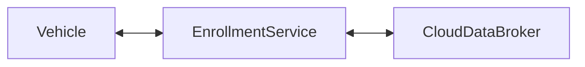

# sdv-ota-fleet-readiness

# Key points


## Design

### Considerations

#### Data plane

##### How might we split the responsibility of orchestration? 

Autonomous networking.

##### How might we realize a edge computing model that is cost effective but still flexible?
https://eclipse.dev/velocitas/docs/concepts/development_model/

##### How might we prove the authenticity of the data broker? 
The level of identity to prove will be at broker level for this purpose.  
The authenticity of each DATA BROKER is proved by possessing the certificate signed by a trusted CA.
The subject name of the Edge broker certificate will use base64 encoded string to represent a unique identifier of the Edge broker.

| Type  | Issuer type(Who am I) | Issuer (Trusted authority) | Subject                                                       |
|-------|-----------------------|----------------------------|---------------------------------------------------------------|
| Cloud | public                | LetsEncrypt                | CN=cloud.sdv.yuwlab.com                                       |
| Edge  | public                | LetsEncrypt                | CN=U2F0IE5vdiAyMSAxMDowMTo1MSBBTSBKU1QgMjAyNgo=.sdv.yulab.com |

#### How might we manage the lifecycle of the certificate?

| Vehicle Lifecycle | Certificate Lifecycle | User experience                                               |
|-------------------|-----------------------|---------------------------------------------------------------|
| acquisition       | issued                | Certificate will be deployed into the car at the time of sale |
| commissioning     | -                     | -                                                             |
| operation         | renew                 | Certficate will be updated at the time of inspection          |
| disposal          | revoke                | Certificate will be revoked when the user releases the car    |

#### How might we proxy the message to the cloud data broker?

Use MQTT over TLS using bridging.

#### How might we decouple the privilege of the certificate chain?

RFC7030



### Tech stack

#### Cloud

| Category                    | Purpose                 | Component            |
|-----------------------------|-------------------------|----------------------|
| REST API                    | Gateway                 | Cloud API Gateway    |
| REST API                    | Service                 | Cloud Run Service    |
| Revisioned Persistent Store | Manifest Management     | Cloud Object Storage |
| Artifact                    | Container Repository    | Artifact Repository  |
| DWH                         | Vehicle state analytics | Bigquery             |
| Control Plane               | Release Pipeline        | n/z                  |
| Management Plane            | Campaign UI             | Streamlit            |
| Data Plane                  | Data broker             | EMQX on GKE          |
| Planes                      | Data                    | PubSub               |

#### Vehicle

| Layer    | Technology                              |
|----------|-----------------------------------------|
| OS       | debian13 on KVM                         |
| Platform | Container orchestrator <br> MQTT broker |
| Apps     | Container                               |

### Architecture

xxx

## Deployment lifecycle

### Init
#### 1.Cloud setup

```shell
cd terraform
terraform init
terraform plan
terraform apply
```

#### 2.EMQX setup

```shell
gcloud container clusters get-credentials data-plane-cluster --zone asia-northeast1-a
make deploy-cloud
```

#### 3.Generate and sign certificate

Since there is no enrollment service, I will mimic the process.
EMQX requires the subjectAltName to be set to the UUID of the device
https://docs.emqx.com/en/emqx/latest/guides/access-control/authn/x509.html#initialize-client-attributes-from-certificate-subject-alternative-names
Use urn to identify the device.
# https://developer.mozilla.org/ja/docs/Web/URI/Reference/Schemes/urn

```shell
make enroll-cred
```

#### 4.Generate sa key

```shell
gcloud iam service-accounts keys create sa-key.json \
  --iam-account data-broker-pubsub-write@$(gcloud config get project).iam.gserviceaccount.com
```

#### Local vehicle setup

1. Create VM

```shell
# Deploy
sudo sh vm-init.sh

# Get kubeconfig
IPV4_ADDR=$(sudo virsh domifaddr vehicle | grep ipv4 | cut -f 15 -d ' ')
scp sdv@${IPV4_ADDR%\/*}:/etc/rancher/k3s/k3s.yaml .
sed -i "s|127.0.0.1|${IPV4_ADDR%\/*}|"  k3s.yaml
```

2. Set cred for Image pulling
# TODO Use workload identity with k8s sa 
```shell
export KUBECONFIG=k3s.yaml
kubectl delete secret regcred -n vehicle
kubectl create secret docker-registry regcred -n vehicle \
  --docker-server=asia-northeast1-docker.pkg.dev \
  --docker-username=oauth2accesstoken \
  --docker-password="$(gcloud auth print-access-token)"
```

2.Deploy apps
```shell
make deploy-vehicle
```

### Test

```shell
# Subscribe on terminal 1
docker run --rm emqx/mqttx-cli:latest mqttx sub -t 'vehicles/vehicle-ebd0f954-082a-438d-beea-0850826d5908/state' -h data-broker-listener.sdv.yuwlab.com -p 1883

# Publish on terminal 2
kubectl exec -n vehicle mosquitto-deployment-8596fc79f6-4p4w2 -- mosquitto_pub  -h localhost -t local/state -m "test"
```

### Teardown

```shell
make clean-all
```